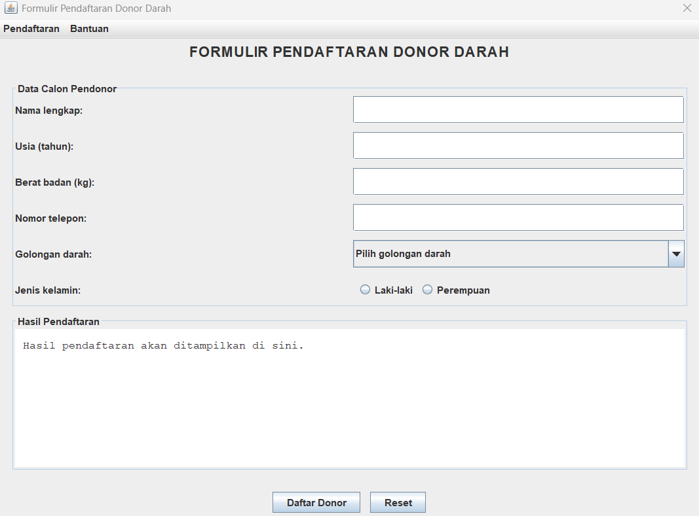
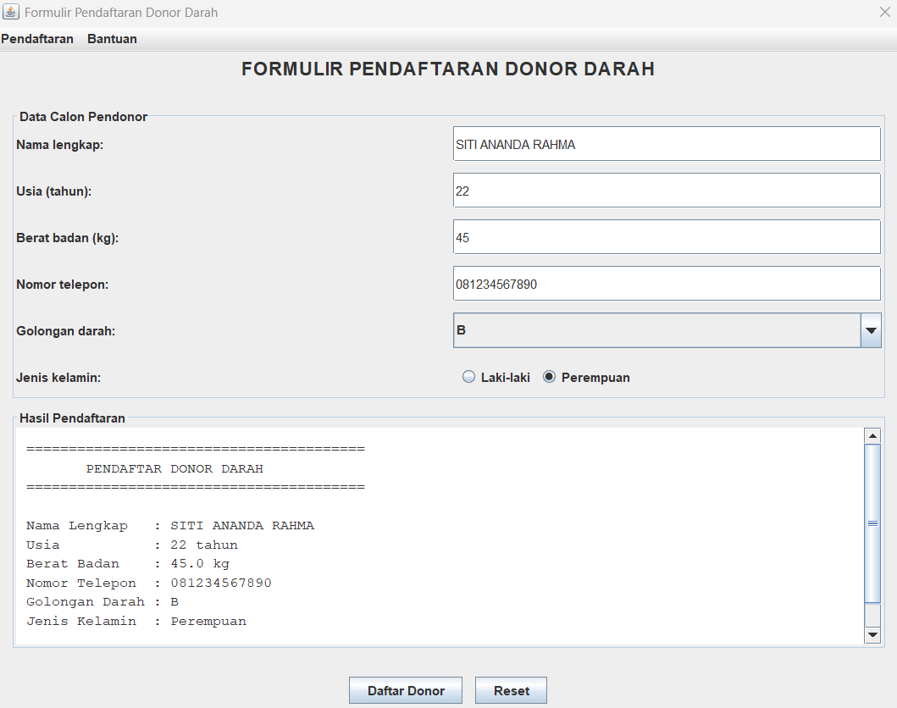
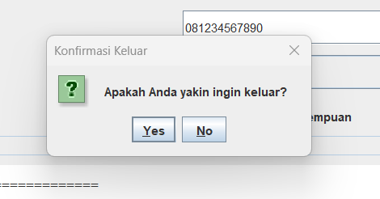

# Aplikasi Formulir Pendaftaran Donor Darah

## 1. Deskripsi Program
Aplikasi Formulir Pendaftaran Donor Darah merupakan program berbasis GUI (Graphical User Interface) yang digunakan untuk simulasi pendaftaran calon pendonor darah. Pengguna dapat mengisi data diri berupa nama lengkap, usia, berat badan, nomor telepon, golongan darah, dan jenis kelamin. Setelah semua data diisi, pengguna dapat menekan tombol **Daftar Donor** untuk menampilkan ringkasan hasil pendaftaran. Tersedia juga tombol **Reset** untuk mengosongkan kembali formulir.

## 2. Lima Komponen Utama GUI yang Digunakan
### A. Top-Level Container Class

**Class: `JDialog`**
JDialog digunakan sebagai jendela utama aplikasi Formulir Pendaftaran Donor Darah. Seluruh komponen GUI seperti menu, formulir, dan tombol ditempatkan di dalam nya.

### B. Intermediate Container Class

**Class: `JMenuBar`, `JMenu`, dan `JMenuItem`**
Komponen ini digunakan untuk membuat menu navigasi pada aplikasi. `JMenuBar` berfungsi sebagai menu utama, `JMenu` sebagai kategori, dan `JMenuItem` sebagai submenu yang dapat diklik pengguna. Contoh pengimplementasian menu pada program:
- Menu Pendaftaran
  - Formulir Pendonor
  - Informasi Donor Darah
  - Keluar
- Menu Bantuan
  - Tentang Aplikasi

### C. Atomic Component Class

**Class: `JComboBox` dan `JRadioButton`**
Atomic Component merupakan komponen GUI yang digunakan untuk menerima input atau menampilkan informasi kepada pengguna.
Komponen yang digunakan:

1. `JComboBox`
   - Digunakan untuk memilih golongan darah.
   - Pilihan yang tersedia adalah A, B, AB, dan O.

2. `JRadioButton`
   - Digunakan untuk memilih jenis kelamin.
   - Pilihan yang tersedia adalah Laki-laki dan Perempuan.
   - Menggunakan `ButtonGroup` agar pengguna hanya dapat memilih satu pilihan.

Selain itu, program juga menggunakan `JTextField` untuk memasukkan data, `JLabel` untuk menampilkan keterangan, `JButton` untuk menjalankan perintah, dan `JTextArea` untuk menampilkan hasil pendaftaran.

### D. Layout Classes
Program menggunakan tiga jenis Layout Manager untuk mengatur posisi komponen GUI.

**1. BorderLayout**
Digunakan untuk mengatur susunan utama aplikasi menjadi bagian atas, tengah, dan bawah.

**2. GridLayout**
Digunakan untuk menyusun label dan kolom input formulir dalam dua kolom dan enam baris.

**3. FlowLayout**
Digunakan untuk mengatur posisi judul, pilihan jenis kelamin, dan tombol agar tersusun secara horizontal.

### E. Event Listener

**Interface: `EventListener`**
Event Listener digunakan untuk menangani tindakan dari pengguna ketika berinteraksi dengan komponen aplikasi, seperti menekan tombol atau memilih menu.

Program menggunakan method `actionPerformed(ActionEvent e)` yang merupakan method dari interface ActionListener. Method tersebut di-override untuk menangani beberapa tindakan, yaitu:
- Tombol Daftar Donor: memvalidasi data dan menampilkan hasil pendaftaran.
- Tombol Reset: mengosongkan seluruh formulir.
- Menu Informasi Donor Darah: menampilkan informasi mengenai donor darah.
- Menu Keluar: menampilkan konfirmasi sebelum menutup aplikasi.
- Menu Tentang Aplikasi: menampilkan informasi aplikasi.
- Menu Formulir Pendonor: mengarahkan fokus ke kolom nama.

## 4. Screenshot Aplikasi

### A. Tampilan Awal Aplikasi

### B. Tampilan Hasil Pendaftaran

### C. Tampilan Konfirmasi Keluar
